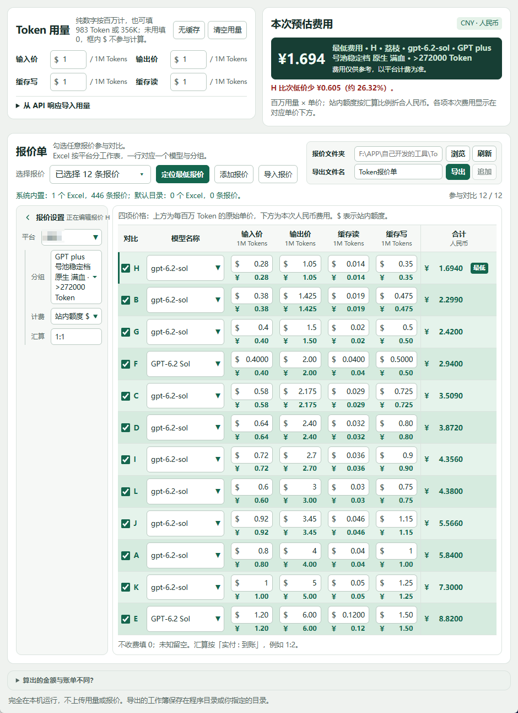
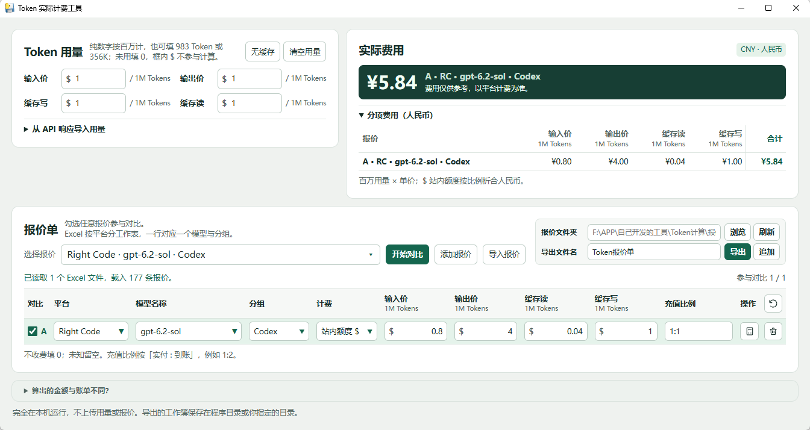

# Token 计费工具

离线计算模型 Token 费用，支持报价搜索、多选对比、粘贴 HTML 导入，以及 Excel 导出和追加。

## 使用

- **Windows 桌面版**：双击 `Token计费工具.exe`。它在独立窗口中打开，不需要 Python 或浏览器标签页。适用于 Windows x64，需安装 Microsoft Edge WebView2 Runtime。窗口高度随内容调整，最高不超过当前显示器工作区；内容放不下时仍可用滚轮、触控板或键盘滚动，但不显示右侧滚动条。
- **网页版**：双击 `启动Token计算.cmd`。也可直接打开 `Token计算.html` 试算，但直接打开时不能扫描或写入 Excel。
- **自定义报价**：默认从 EXE 或网页版程序旁的 `报价单文件` 目录读取 Excel，也可在界面指定其他本地目录。携带程序时，想保留已有报价需一起复制报价目录。
- **系统报价**：只读取程序旁 `报价单/系统报价单.xlsx` 或 `报价单/内置报价单.xlsx`，没有工作簿就没有系统报价。不会在 JavaScript 或 EXE 中内嵌兜底价格。删除后刷新报价目录或重新打开程序即可；`报价单文件` 中的自定义报价不受影响。历史备份不会被扫描。
### 最新


### 旧


## 用量与报价联动

- 纯数字仍按百万 Token 计。平台显示 `983` 个 Token 时，可写 `983 Token`、`0.983K` 或 `0.000983M`。
- 平台和模型支持搜索选项或手输。报价行编辑完平台、模型或分组后，按这三项匹配已加载的 Excel 报价。仅在唯一匹配时同步四种单价、币种及充值比例；没有匹配或有多条匹配时保留当前值。若在 Excel 中直接改了文件，请先点「刷新」。

## 打包为单文件 EXE

在 Windows x64 上使用 Python 3.12。在程序根目录打开 PowerShell，建议创建独立的构建环境：

```powershell
py -3.12 -m venv .venv-build
.\.venv-build\Scripts\python.exe -m pip install -r .\桌面版\requirements.txt
.\.venv-build\Scripts\python.exe .\桌面版\build_desktop.py
```

产物为 `dist/Token计费工具.exe`。测试通过后关闭旧窗口，再用新 EXE 替换旧文件。单文件包含界面和 Python 依赖，不包含用户工作簿；WebView2 仍由 Windows 提供。修改源代码后需要重新打包，已经生成的 EXE 不会自动更新。此版本没有发行者代码签名。

更多用量单位、报价工作表格式和操作说明见 [使用说明](使用说明.md)。
# 我的社交媒体
单击放大图片扫码
<table style="border: 1px solid #9FA0A0; border-collapse: collapse; width: auto;">
    <tr>
      <th style="border: 1px solid #9FA0A0; padding: 0; background-color: #000000; text-align: center; height: auto; width: auto;">
        <a href="https://discord.gg/ArErrjXT53" rel="noopener noreferrer">
          </a>DC社区</th>
      <th style="border: 1px solid #9FA0A0; padding: 0; background-color: #000000; text-align: center; height: auto;">
      <a rel="noopener noreferrer">
          </a>小红书主页</th>
        <th style="border: 1px solid #9FA0A0; padding: 0; background-color: #000000; text-align: center; height: auto; width: auto;">
        <a rel="noopener noreferrer">
          </a>加微信好友</th>
      <th style="border: 1px solid #9FA0A0; padding: 0; background-color: #000000; text-align: center; height: auto;">
      <a rel="noopener noreferrer">
          </a>请我喝咖啡WX</th>
    </tr>
</table>
